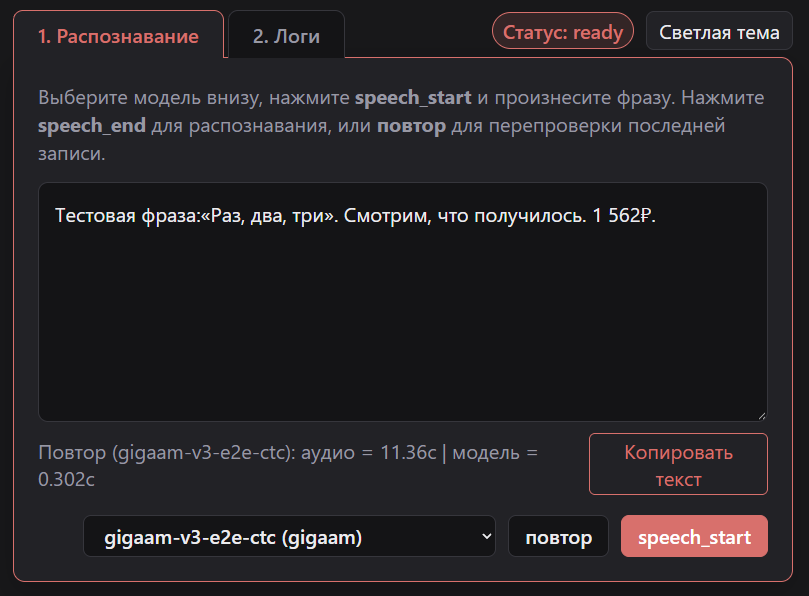

# Local STT Microservice

Локальный высокопроизводительный REST-микросервис для захвата речи с микрофона и её офлайн-распознавания в текст (
Speech-to-Text). Спроектирован для простой интеграции в десктопные и серверные приложения в качестве управляемого
фонового процесса.

---

## Ключевые особенности и преимущества

* **Мультидвижковая плагинная архитектура (`BaseSTT`):** Единый интерфейс для разных семейств моделей с автоопределением
  движка по имени папки:
    * **GigaAM (ONNX):** Сверхбыстрое и точное распознавание русской речи с расставлением пунктуации, заглавных букв и
      нормализацией цифр (через `onnx-asr`, без тяжёлого `PyTorch`).
    * **Faster-Whisper (CTranslate2):** Высокая точность на мультиязычной речи, англицизмах и IT-терминах с поддержкой
      GPU (`CUDA`).
    * **Vosk:** Сверхлёгкий офлайн-движок для слабых машин и работы исключительно на CPU.
* **Graceful Degradation (отказоустойчивость GPU):** При запуске Whisper на машинах с отсутствующими или повреждёнными
  драйверами CUDA сервис автоматически перехватывает ошибку (как при загрузке, так и при первом инференсе) и бесшовно
  переключается на `CPU (int8)`.
* **Горячая смена моделей и буфер повтора (`/repeat`):** Последняя записанная аудиофраза кэшируется в оперативной памяти
  до начала следующей записи. Это позволяет менять модели через `/set-model` и повторно распознавать ту же фразу через
  `/repeat` без повторной надиктовки.
* **Сквозная трассировка и приватность логов:** Поддерживает передачу внешнего `--request-id` при запуске процесса (
  удобно при оркестрации через `subprocess`). Логи на базе `loguru` пишутся с ротацией и архивацией, при этом *
  *распознанный текст пользователя никогда не записывается в логи** (фиксируются только длина строки и тайминги).
* **Автономная сборка (`.exe`):** Готовый скрипт `build.py` собирает проект в многофайловый Windows-дистрибутив (
  `--onedir`) со всеми нативными библиотеками и внешними директориями `models/` и `config.json`.

* **Добавлен ui для быстрого ручного использования**

<a href="docs/screen.PNG" target="_blank">

</a>

---

## Архитектура проекта

Сервис построен по принципу конечного автомата (`STOPPED` → `READY` → `RECORDING` → `PROCESSING` → `READY`) с
потокобезопасной блокировкой состояний.

```text
ms_stt/
├── models/                  # Локальные директории с весами моделей (GigaAM, Whisper, Vosk)
├── logs/                    # Логи работы сервиса с ротацией по 10 МБ (создаётся автоматически)
├── releases/                # Скомпилированные билды PyInstaller (создаётся при сборке)
├── app/
│   ├── __init__.py
│   ├── logger.py            # Настройка loguru, сквозной request_id, ротация логов
│   ├── config.py            # Pydantic-схема настроек, чтение/сохранение config.json
│   ├── audio_input.py       # Неблокирующий захват PCM-аудио (16 kHz, mono, int16) через sounddevice
│   ├── stt_module.py        # Плагинный реестр (@register_stt) и адаптеры GigaAM, Whisper, Vosk
│   ├── engine.py            # Оркестратор состояний, замер таймингов и кэш аудио для /repeat
│   └── api.py               # REST-эндпоинты FastAPI
├── config.json              # Файл конфигурации (генерируется автоматически при первом старте)
├── main.py                  # Точка входа: парсинг CLI-аргументов (--host, --port, --request-id)
├── build.py                 # Скрипт автоматической сборки в .exe через PyInstaller
└── pyproject.toml           # Описание проекта и зависимостей (uv)
```

---

## Установка и настройка окружения

> На linux требуется libportaudio2: `sudo apt update && sudo apt install -y libportaudio2`


Проект использует менеджер пакетов **`uv`**.

1. **Клонируйте репозиторий и перейдите в директорию проекта:**
   ```bash
   git clone git@github.com:Mike2024New/ms_stt.git ms_stt
   cd ms_stt
   ```

2. **Синхронизируйте зависимости и создайте виртуальное окружение:**
   ```bash
   uv sync
   ```
   *(Для разработки и сборки в `.exe` также установите PyInstaller: `uv add --dev pyinstaller`)*

---

## Подготовка моделей и быстрый запуск

### 1. Загрузка моделей в `models/`

Сервис работает полностью офлайн и сканирует подпапки внутри `models/`. Тип движка определяется автоматически по
названию папки:

* Содержит `vosk` → плагин **Vosk**.
* Содержит `gigaam` → плагин **GigaAM (ONNX)**.
* Все остальные → плагин **Faster-Whisper**.

Примеры структуры папки `models/`:

* `models/gigaam-v3-e2e-ctc/` — файлы `config.json`, `v3_e2e_ctc.onnx` (или `.int8.onnx`), `v3_e2e_ctc_vocab.txt`.
* `models/whisper-small/` — файлы конвертированной модели CTranslate2 (`model.bin`, `config.json`, `tokenizer.json`,
  `vocabulary.txt`).
* `models/vosk-model-small-ru-0.22/` — распакованный архив модели Vosk (`am/`, `conf/`, `graph/`, `ivector/`).

### 2. Запуск сервера

Запустите сервис с указанием нужного порта и сквозного идентификатора сессии:

```bash
uv run main.py --port 8002 --request-id 1234
```

Доступные параметры запуска (также можно задавать через переменные окружения `STT_HOST`, `STT_PORT`, `STT_REQUEST_ID`):

* `--host` — хост сервера (по умолчанию `127.0.0.1` из `config.json`).
* `--port` — порт сервера (по умолчанию `8000` из `config.json`).
* `--request-id` — сквозной идентификатор процесса для логов и заголовка `X-Request-ID` (если не задан, генерируется
  автоматически).

После запуска интерактивная документация Swagger UI доступна по адресу: `http://127.0.0`.

---

## Сборка в исполняемый файл (.exe)

Для создания автономного многофайлового дистрибутива Windows (`--onedir`) выполните:

```bash
uv run build.py
```

Готовая сборка появится в директории **`releases/stt_service/`**. Рядом с `stt_service.exe` автоматически создаётся
папка `models/` и копируется шаблон `config.json`.

Пример запуска скомпилированного бинарника (в том числе через `subprocess` из родительского приложения):

```bash
releases\stt_service\stt_service.exe --port 8002 --request-id session-01
```

---

## Справочник REST API

Все `GET`-эндпоинты безопасны и используются только для чтения состояния. Все `POST`-эндпоинты управляют жизненным
циклом, памятью или записью.

| Метод  | Эндпоинт        | Описание                                                                                                                |
|:-------|:----------------|:------------------------------------------------------------------------------------------------------------------------|
| `GET`  | `/health`       | Проверка работоспособности сервиса, текущий статус движка и наличие кэша аудио.                                         |
| `GET`  | `/info`         | Подробная справка по статусам, сценарию работы и всем доступным методам.                                                |
| `GET`  | `/models`       | Список доступных папок в `models/` с указанием определённого движка и активной модели.                                  |
| `POST` | `/set-model`    | Выбор активной модели (`{"model_name": "..."}`). Делает hot-reload при запущенном движке, сохраняя буфер для `/repeat`. |
| `POST` | `/start`        | Загрузка выбранной модели в память (RAM/VRAM). Переводит сервис в статус `ready`.                                       |
| `POST` | `/stop`         | Остановка записи, очистка буфера, выгрузка модели из памяти. Переводит сервис в статус `stopped`.                       |
| `POST` | `/speech_start` | Очистка старого буфера и начало захвата PCM-аудио с микрофона (`recording`).                                            |
| `POST` | `/speech_end`   | Остановка записи, сохранение аудио в буфер, распознавание и возврат текста с таймингами.                                |
| `POST` | `/repeat`       | Повторное распознавание последнего сохранённого аудиофрагмента на текущей модели.                                       |

### Типовой сценарий работы клиента

1. `GET /models` → получить список моделей.
2. `POST /set-model` → выбрать нужную модель (например, `{"model_name": "gigaam-v3-e2e-ctc"}`).
3. `POST /start` → загрузить веса в память (`status: "ready"`).
4. `POST /speech_start` → начать запись речи (`status: "recording"`).
5. `POST /speech_end` → завершить запись и получить JSON-ответ:
   ```json
   {
     "text": "123 551 рубль.",
     "duration_sec": 5.77,
     "processing_sec": 0.42,
     "total_sec": 6.21
   }
   ```
6. *(Опционально)* Сменить модель через `POST /set-model` и вызвать `POST /repeat`, чтобы прогнать ту же аудиозапись
   через другой движок.
7. `POST /stop` → выгрузить модель и освободить память по окончании работы.

---

## Используемые технологии, модели и лицензии

В проекте используются следующие открытые решения и модели (при распространении коммерческих или публичных сборок
учитывайте условия их лицензий):

* **GigaAM (SberDevices)** — семейство акустических и end-to-end моделей для русского и мультиязычного распознавания
  речи.
    * Исходный код и веса: [salute-developers/GigaAM](https://github.com) / [ai-sage/gigaam](https://huggingface.co)
    * ONNX-сборки и рантайм: [istupakov/gigaam-v3-onnx](https://huggingface.co) и
      библиотека [onnx-asr](https://github.com)
    * **Лицензия:** MIT License.

* **Whisper / Faster-Whisper (OpenAI / SYSTRAN)** — мультиязычная модель распознавания речи на базе архитектуры
  Transformer, ускоренная через движок `CTranslate2`.
    * Репозитории: [openai/whisper](https://github.com) и [SYSTRAN/faster-whisper](https://github.com)
    * **Лицензия:** MIT License.

* **Vosk (Alpha Cephei)** — компактный офлайн-инструментарий распознавания речи на базе Kaldi.
    * Репозиторий и модели: [alphacep/vosk-api](https://github.com) / [://alphacephei.com](https://://alphacephei.com)
    * **Лицензия:** Apache License 2.0.
